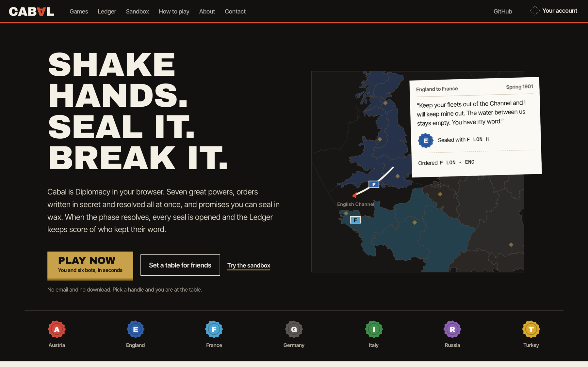
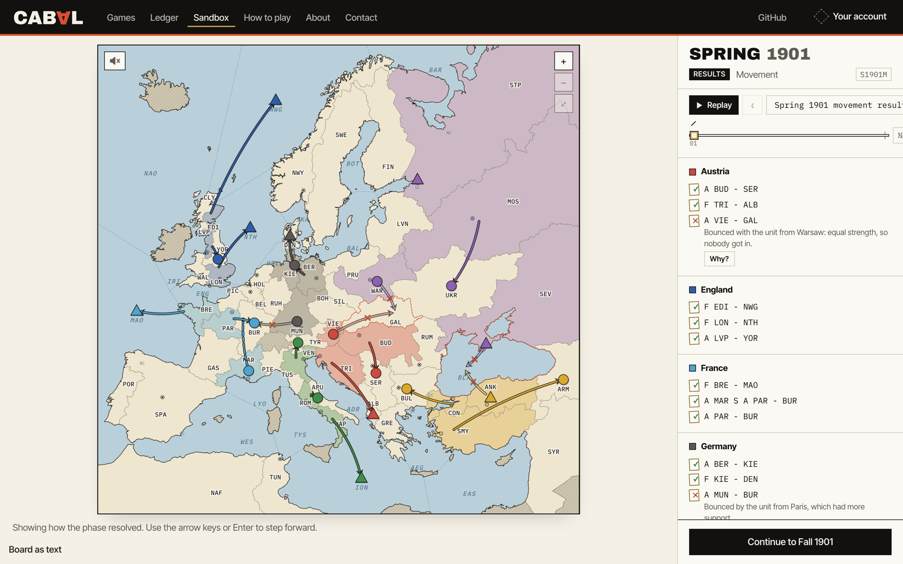
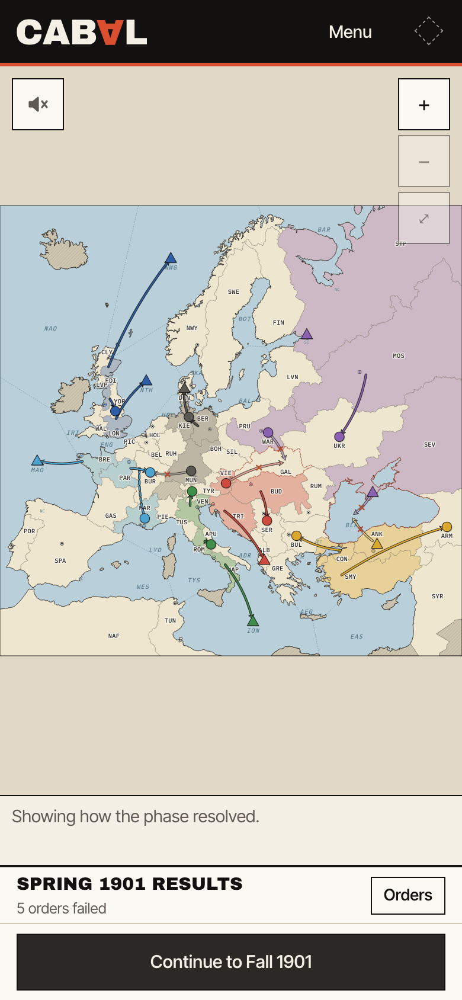
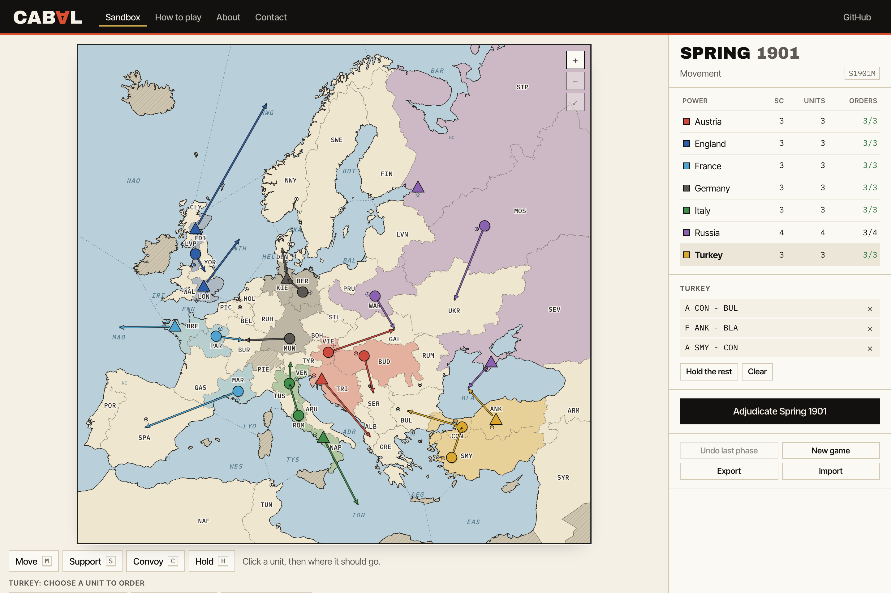
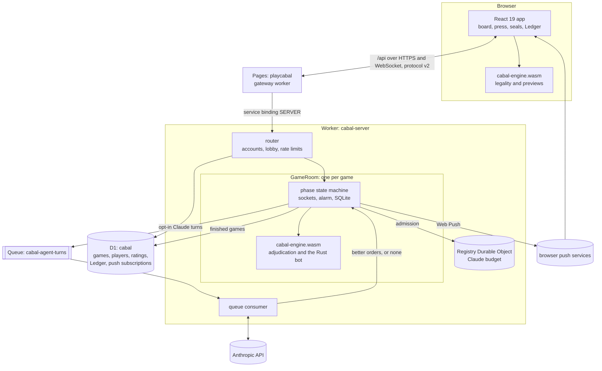

<div align="center">

<picture>
  <source media="(prefers-color-scheme: dark)" srcset="docs/brand/wordmark-dark.svg" />
  <source media="(prefers-color-scheme: light)" srcset="docs/brand/wordmark.svg" />
  
</picture>

**Diplomacy with receipts.** The classic game of alliances and betrayal in your browser, where every promise can be sealed in wax and every broken one goes on the record.

[](https://github.com/KarthikSubramanian07/Cabal/actions/workflows/ci.yml)
[](https://github.com/KarthikSubramanian07/Cabal/actions/workflows/stress.yml)
[](LICENSE)
[](https://playcabal.pages.dev)


`diplomacy` `board-game` `negotiation` `rust` `webassembly` `cloudflare-workers` `durable-objects` `d1` `react` `web-push` `game-ai` `datc`

**[Play now](https://playcabal.pages.dev)** · [The sandbox](https://playcabal.pages.dev/sandbox) · [The Ledger](https://playcabal.pages.dev/ledger) · [Architecture](docs/ARCHITECTURE.md) · [Protocol](docs/PROTOCOL.md) · [Rules decisions](docs/RULES.md) · [Integrations](docs/INTEGRATIONS.md) · [ADRs](docs/adr/)

</div>

<p align="center">
  
</p>

---

Spring, 1901. Seven great powers, one map of Europe, and nothing to stop you lying to all six of your neighbours. Diplomacy has no dice and no luck: every player writes orders in secret, every order resolves at once, and the only way to win is to talk someone into trusting you and then decide whether to deserve it.

It is the greatest negotiation game ever designed, and online it has mostly lived in forums. Cabal keeps the rules exactly as tournament players know them and rebuilds the table around them. It loads in a browser tab, plays on a phone, fills empty seats with a bot that never stalls, and adds the one thing the board never had: proof of who kept their word.

## What makes it Cabal

**Seals.** Any dispatch can carry a sealed pledge: the exact orders you promise to give, committed on your own device as a BLAKE3 hash with a random nonce. Nobody can read a seal before the phase resolves, and nobody, the server included, can change one afterwards.

**Receipts.** When the phase resolves, every seal is opened and stamped **kept**, **broken** or **void**, and every order on the board gets a reason in plain words: *bounced with the unit from Warsaw, equal strength, so nobody got in*; *support cut by F Kie*; *no convoy path*. Nobody has to argue about what happened.

**The Ledger.** Every seal opened in a rated game goes on a public record that follows a player from table to table. Trust is (kept + 5) ÷ (kept + broken + 10), so everyone starts at 50 percent and one promise can neither make nor ruin a name. Skill is rated separately, with a weighted pairwise Glicko-2 ([ADR 0011](docs/adr/0011-weighted-pairwise-glicko-2.md)), and so is reliability: whether you file your orders on time.

**The bot that always plays.** Every empty seat, and every seat whose player has gone quiet, is played by a deterministic heuristic bot written in Rust that searches its candidate orders on the real adjudicator. It costs nothing, answers instantly and never holds a phase up. Press *Play now* and you are at a full table with six of them in seconds. See [docs/BOT.md](docs/BOT.md).

**Claude, when you ask for it.** A table can opt in to Claude brains instead (`aiBrain: "claude"`): agents with a persona, a private diary and a memory of who lied to them, negotiating through the same protocol a human uses. Their turns run through a queue under a hard spend cap per game and a daily budget for the whole deployment, and any failure leaves the bot's orders standing. It is off unless the server has an API key.

**No dead games.** Live, daily or async clocks (ten minutes, a day or two days a move by default), ready-to-advance, sealed default orders, civil disorder covered by the bot after two missed phases, substitutes after four, and a game that no human is playing ends on its own instead of playing itself forever.

None of this changes the rules. Every layer reads the adjudication result and never writes it ([ADR 0004](docs/adr/0004-cabal-layer-above-adjudication.md)). Cabals, vendettas and ghost votes are next ([plan](docs/PLAN.md)).

## The board

| Spring 1901, adjudicated | On a phone |
|---|---|
|  |  |

The map is the one Diplomacy players know, drawn fresh from real geography. `tools/mapgen` assigns every Natural Earth region (public domain) to one of the 75 classic provinces, dissolves them with shared borders intact, cuts the seas along the printed board's lines and checks every drawn border against the engine's adjacency table. Nothing is traced from anyone's artwork, so the map ships under MIT with the code.

Ordering works the way Backstabbr players expect: click a unit, then where it goes; click it twice to hold; <kbd>S</kbd> to support, <kbd>C</kbd> to convoy, or the buttons under the map on a touch screen. Only legal orders are offered, fleets bound for Spain, Bulgaria or St Petersburg get a coast picker, and every phase can be replayed, undone, exported and imported as a MILA saved game.

<p align="center">
  
</p>

## Architecture



- **One engine, two hosts.** `crates/cabal-engine` is compiled once to WebAssembly (about 384 KB gzipped with the bot inside; CI fails above 409 KB). The browser uses it for instant legality checks and what-if previews, the `GameRoom` uses the same bytes as the authority, so they cannot disagree.
- **The bot lives next to the rules.** `crates/cabal-bot` is compiled into the same module and exported as `botOrders`. The room puts the bot's orders on file the moment a phase opens, so an AI seat is never late.
- **One object owns one game.** Positions, orders, press, seals, the deadline alarm and every socket live in a single SQLite-backed Durable Object. Adjudicate, persist and broadcast is one transaction; a retried alarm can never resolve a phase twice.
- **Cross-game data in D1.** Finished games, public listings, guest players, ratings, reliability, the Ledger and push subscriptions live in the D1 database `cabal`, behind two narrow ports (`GameIndex` and `PlayerStore`) with plain SQL in numbered migrations ([ADR 0010](docs/adr/0010-d1-index-registry-for-the-claude-budget.md)). A room hands its finished game over through a durable outbox; recording is idempotent and a game is rated at most once.
- **One small Registry.** A singleton `Registry` Durable Object stays deployed for the one job that wants a single writer: the deployment-wide Claude budget, where two games asking at once must never both take the last place.
- **One origin.** The browser only ever talks to `playcabal.pages.dev`. The Pages gateway worker serves the prerendered front door and app shell, answers `Accept: text/markdown` for agents, and forwards `/api/*`, WebSocket upgrades included, to `cabal-server` through a service binding, so the content security policy stays `connect-src 'self'`.
- **Protocol v2.** One WebSocket per client, zod schemas in `@cabal/protocol`, a first `hello` frame to bind a seat (tokens never appear in URLs), a sequence number on every broadcast, and `sync { since }` to resume after a dropped connection. A test fails when [PROTOCOL.md](docs/PROTOCOL.md) and the schemas disagree.
- **Web Push without a library.** RFC 8291 encryption and RFC 8292 VAPID with Web Crypto alone. A player who is away hears that a phase resolved, that a dispatch arrived or that orders are due, and never what the orders or the press said.

The full picture, with the per-game schema, the alarm, identity, notifications and metrics, is in [docs/ARCHITECTURE.md](docs/ARCHITECTURE.md).

## The engine

`crates/cabal-engine` is a pure, deterministic Diplomacy adjudicator with no I/O and no randomness.

- **Kruijswijk's partial information algorithm** from DATC v3.0 chapter 5: every order is a Boolean equation over attack, hold, defend and prevent strengths, resolved with memoisation, cycle detection and the two backup rules (circular movement succeeds; convoy paradoxes fail the convoys, per Szykman). No "cut supports first" heuristics.
- **Explanations, not Booleans.** Every outcome says why, and `cabal explain --graph` draws the dependency graph the resolver actually walked.
- **178 adjudication cases:** all 171 Diplomacy Adjudicator Test Cases v3.0 and 7 of Cabal's own, checked for dislodgements, standoffs and retreats as well as order outcomes; an independent position oracle transcribed from godip; property tests; replay fixtures including a complete published Cicero game; criterion benches with a regression gate; fuzz targets.
- **Editions as data.** The 1971, 1982, 2023 and DPTG rulebooks differ only in `Rulebook` fields.
- **Interop.** Orders and saved games use the MILA / Cicero notation, so published AI Diplomacy harnesses can read Cabal games.

```sh
cargo run -p cabal-cli -- datc --report        # every case, per section; the last line reads "total: 178 passed"
cargo run -p cabal-cli -- explain "ENG: F NTH - HOL" "ENG: A BEL S F NTH - HOL" "GER: A HOL H"
cargo run -p cabal-cli -- replay crates/cabal-engine/tests/data/games
cargo run --release -p cabal-cli -- arena --games 100   # the bot against itself, with a strength table
```

## Quickstart

You need Rust (the toolchain file picks 1.97 and the wasm target), `wasm-pack`, Node 24 and pnpm.

```sh
rustup show && cargo install wasm-pack
corepack enable && pnpm install
pnpm engine:build     # cabal-engine and the bot to packages/engine/pkg
pnpm dev              # the site on :5173, cabal-server on :8787 with a local D1 database
```

Open http://localhost:5173 and press *Play now*. The dev server proxies `/api` to the local Worker exactly as the gateway does in production. Claude seats stay off unless you set `ANTHROPIC_API_KEY`; push stays off unless you set a VAPID key pair (see [apps/server/README.md](apps/server/README.md)).

## Testing

| Command | What it proves |
|---|---|
| `cargo test --workspace` | the 178 adjudication cases, the godip oracle, property tests, replays, the bot's golden transcript |
| `pnpm check` | typecheck, lint, and the unit suites, including the Worker suites inside workerd against real Durable Objects, alarms, D1 and the queue |
| `pnpm test:e2e` | the Playwright suite against the built site, every test on a desktop and on a phone, with axe accessibility checks |
| `pnpm test:e2e:live` | the site against `cabal-server` under `wrangler dev`: the front door, the lobby, whole turns and a full game, desktop and phone |

CI runs all of it on every pull request, plus the wasm and Worker size budgets, a benchmark gate, a GameRoom cold start gate and a credential-free `wrangler deploy --dry-run`. The nightly Stress workflow fuzzes the parser, runs the property tests with a larger budget and plays 300 bot games, failing on any illegal order or replay divergence. No test ever calls a paid API.

The number of cases quoted on the site, in this README and in the docs is checked against the fixtures themselves (`apps/web/src/app/adjudication.test.ts`), so it cannot drift.

## Deploying

Merging to `main` deploys nothing. A maintainer runs one command from a green `main`:

```sh
pnpm deploy:all   # D1 migrations, then cabal-server, then the site to Pages
```

CI holds no Cloudflare credentials ([ADR 0008](docs/adr/0008-manual-wrangler-deploys.md)). The runbook, with previews, rollback, the health check and both kinds of migration, is in [CONTRIBUTING.md](CONTRIBUTING.md#deploying).

## Project layout

```
crates/cabal-engine   the rules: geo, orders, parser, resolver, phases, saved games, pledges
crates/cabal-bot      the heuristic player, searched on the real adjudicator
crates/cabal-wasm     wasm-bindgen bindings; TypeScript types generated from Rust
crates/cabal-cli      cabal: datc, explain, legal, replay, arena
packages/engine       @cabal/engine     the wasm build as an npm package
packages/protocol     @cabal/protocol   zod schemas and the typed client for protocol v2
packages/agents       @cabal/agents     Claude players: personas, diaries, legal order repair
apps/server           @cabal/server     Worker, GameRoom and Registry, D1 migrations, Web Push
apps/web              @cabal/web        Vite and React 19 on Pages, the gateway worker, the service worker
tools/mapgen          the board, from Natural Earth to board.json
fuzz                  cargo-fuzz targets
docs                  architecture, protocol, rules, bot, performance, brand, ADRs
```

## Contributing

Start with [CONTRIBUTING.md](CONTRIBUTING.md) and [docs/ONBOARDING.md](docs/ONBOARDING.md). Rules questions are settled by DATC v3.0 first and [docs/RULES.md](docs/RULES.md) second; engine changes ship with tests; every order outcome carries an explanation; and the brand is ink, bone, brass and vermilion ([docs/BRAND.md](docs/BRAND.md)), with vermilion kept for failure and betrayal.

## Credits

Cabal is built by its contributors:

- [KarthikSubramanian07](https://github.com/KarthikSubramanian07), who started it and maintains it.
- [justinobomeghie](https://github.com/justinobomeghie): order normalisation, the godip oracle, fuzzing and the explanation graph in the engine, and the GameRoom's complete lifecycle on the server.
- [mattsu-sketch](https://github.com/mattsu-sketch): replay fixtures, variant maps, fog of war views, the benchmark gate, convoy route choice, typed MILA orders with autocomplete, animated adjudication and phase history playback.
- [Froggo21](https://github.com/Froggo21): the web lobby, the games room and the installable app shell.
- [DRL49erman2](https://github.com/DRL49erman2): the agents' decision records, cost estimates and token accounting.

It stands on other people's work. Before writing code we read the adjudicators of the MILA `diplomacy` engine, godip, the MIT `diplomacy` crate, stpsyr and jDip; the DATC and "The Math of Adjudication" by Lucas Kruijswijk; the Cicero, DipNet, SearchBot, Welfare Diplomacy, DipLLM and AI Diplomacy papers and harnesses; and the feature lists and complaints of webDiplomacy, Backstabbr, Playdiplomacy, Diplicity and Conspiracy. Thirty-two real adjudication bugs from those projects' issue trackers became regression tests here.

Test data: the DATC v3.0 corpus and the standard map's province tables are derived from [TedDriggs/diplomacy](https://github.com/TedDriggs/diplomacy) (MIT); the DATC itself is by Lucas B. Kruijswijk. The oracle corpus transcribes positions from [zond/godip](https://github.com/zond/godip) (GPL-3.0) and is test-only data that ships in no build; the Cicero fixture is an excerpt of a [Meta Cicero](https://github.com/facebookresearch/diplomacy_cicero) game (MIT). Details are in [crates/cabal-engine/data/NOTICE.md](crates/cabal-engine/data/NOTICE.md). The map is drawn from [Natural Earth](https://www.naturalearthdata.com/) (public domain). Diplomacy was designed by Allan B. Calhamer; Cabal is an independent project and is not affiliated with its publishers.

## License

MIT. See [LICENSE](LICENSE).
