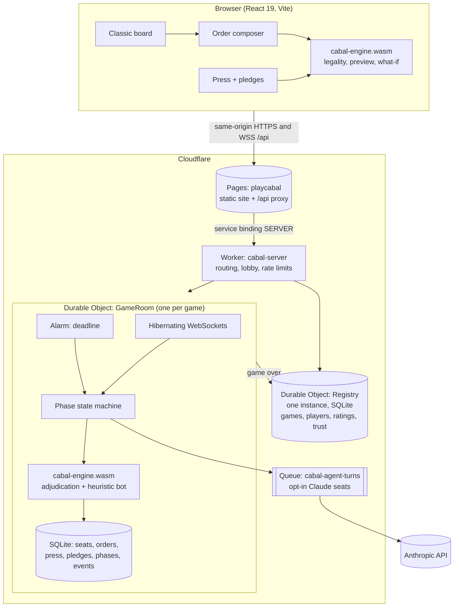
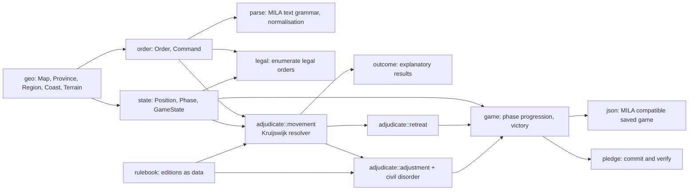
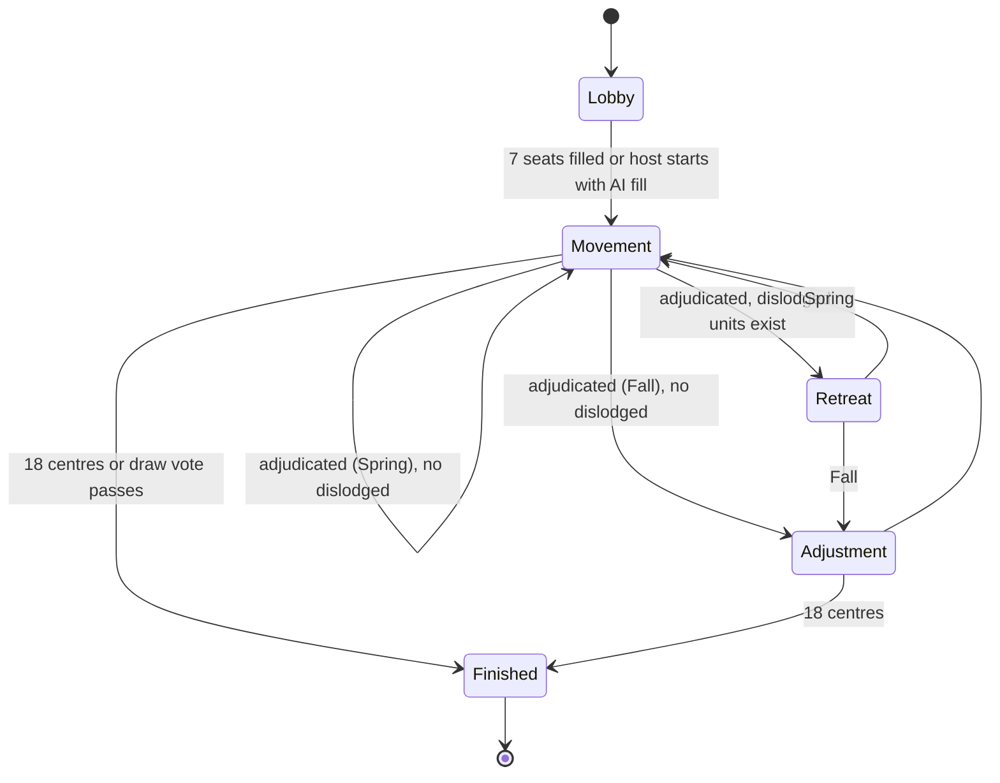

# Architecture

## 1. System overview



Four principles:

1. **One engine, two hosts.** The Rust crate is compiled once to WebAssembly. The browser uses it for instant feedback; the Durable Object uses it as the authority. They cannot disagree because they are the same bytes.
2. **One object owns one game.** All state for a game (positions, orders, press, pledges, deadlines, sockets) lives in one Durable Object with SQLite storage. Adjudication, persistence and broadcast are one transaction. No cross-service hop on the hot path.
3. **Layers above the line never touch the resolver.** Pledges, cabals, vendettas and ratings consume adjudication results. They cannot change them.
4. **One origin.** The browser only ever talks to `playcabal.pages.dev`. The Pages project proxies `/api/*`, including WebSocket upgrades, to the `cabal-server` Worker through a service binding named `SERVER`, so the content security policy can stay `connect-src 'self'`. In `vite dev` the same path is proxied to `http://localhost:8787`. Status: being built in phase 1; on `main` today the web app is a local sandbox that does not call the API.

## 2. Repository layout

```
cabal/
  crates/
    cabal-engine/    pure Rust: geo, orders, parser, resolver, phases, legality, json, pledges
    cabal-wasm/      wasm-bindgen + tsify bindings, generates TypeScript types
    cabal-cli/       `cabal` CLI: datc, explain, legal, replay, version
  packages/
    engine/          @cabal/engine  npm wrapper around the wasm-pack output
    protocol/        @cabal/protocol  zod schemas for WebSocket and HTTP messages
    agents/          @cabal/agents  LLM player harness
  apps/
    web/             @cabal/web  Vite + React 19, Cloudflare Pages
    server/          @cabal/server  Worker + GameRoom Durable Object
  docs/              PLAN, ARCHITECTURE, RULES, PROTOCOL, ADRs, diagrams
  .github/           CI, issue and PR templates
```

## 3. The engine (`crates/cabal-engine`)

### 3.1 Module map



### 3.2 Domain types

- `ProvinceId(u8)`: index into the map. `Region { province, coast: Option<Coast> }` is the thing a unit stands on (fleets on `stp` are on `stp(nc)` or `stp(sc)`).
- `Terrain::{Land, Coast, Sea}` on provinces; `Border { a: Region, b: Region, terrain }` on edges. An army crosses `Land` and `Coast` borders, a fleet crosses `Coast` and `Sea` borders. Coastal provinces are represented by one region per coast plus the land region, following the MIT `diplomacy` crate design.
- `Unit { power, kind: Army | Fleet, region }`.
- `Order { power, unit_kind, origin: Region, command }` with `Command::{Hold, Move { dest, via_convoy }, SupportHold { target }, SupportMove { target, dest }, Convoy { army, dest }}` for movement, `RetreatCommand::{Retreat(Region), Disband}` and `AdjustCommand::{Build(kind, Region), Disband(ProvinceId), Waive}`.
- `Outcome` enums explain every result: `Move::{Succeeds, Bounced(by), NoPath, Repelled, LostHeadToHead, FriendlyFire, ...}`, `Support::{Succeeds, Cut(by), Dislodged, Void}`, `Convoy::{Succeeds, Dislodged, Paradox}`.

### 3.3 Resolution

The movement resolver implements the partial information algorithm from DATC v3.0 chapter 5.E (Kruijswijk). Every order has a Boolean result that never changes once decided. `adjudicate(order, optimistic)` evaluates the rule equations (attack, hold, defend, prevent strength, path, support cut, convoy) using optimistic or pessimistic values for anything undecided; `resolve(order, optimistic)` memoises, detects dependency cycles with a `recursion_hits` counter, and applies the backup rule (circular movement succeeds; convoy paradox fails the convoys per Szykman). Illegal orders are stripped before resolution and never influence it. After resolution a final explanation pass turns Booleans into `Outcome` values.

`resolve_movement_with_dependencies` additionally returns `MovementDependencies`:
order and outcome nodes in stable region order, with sorted, deduplicated edges
`(a, b)` when resolving order `a` queries order `b`. Cached queries and cycle
edges are included; final explanation queries are excluded. This is an execution
trace of the equations queried, so short-circuited branches need not appear.
`MovementDependencies::to_dot(map, position)` renders labelled Graphviz DOT.
`cabal explain --graph "FRA: A PAR - BUR" "FRA: A MAR S A PAR - BUR"`
prints a standalone graph suitable for piping to `dot -Tsvg`. The original
`resolve_movement` API and result schema are unchanged. Over WASM the trace is
computed only on demand: `Game.explain(index)` re-runs the movement phase at
that history index with tracing and returns `{ edges, dot }`, where edges index
the phase outcome's `results`. Phase outcomes themselves carry no trace, so
processing, previews and history lookups never pay for it.

`order::normalise(map, position, order)` validates against the actual board unit
and canonicalises destination coasts. The additive WASM `Game.normaliseOrders`
method is shared by server adjudication and browser sandbox adjudication/replay
before `Game.process`. Invalid and duplicate orders are retained for diagnostics;
typed WASM processing also normalises movement orders.

Pre-processing decides statically whether an adjacent move uses a convoy (edition policy), matches supports and convoys to moves, and identifies head-to-head pairs (never when either side is convoyed).

### 3.4 Determinism and testing

- No I/O, no randomness in adjudication. Civil disorder tie breaks are alphabetical by province name.
- DATC v3.0 corpus (171 cases, Main, Retreat, Build, editions) drives `tests/datc.rs`. The independent `oracle_godip.json` corpus asserts full units, dislodgements, and owners for 18 godip production cases plus two official DATC cases. Provenance, phase-boundary adapters and the DATC 6.K note are in [ENGINE_VERIFICATION.md](ENGINE_VERIFICATION.md).
- Property tests (`proptest`): random legal order sets never panic, resolution is independent of order submission sequence, relabelling powers relabels outcomes.
- Explanation tests (`tests/dependencies.rs`) assert the dependency edges traced for supported attacks, cycles, convoys and illegal orders; the DATC corpus run also checks that tracing never changes a result and that the trace and its DOT are identical when orders are submitted in reverse.
- `criterion` benches: full board adjudication and explanation, legal order enumeration, map start-up. The CI `bench` job runs opening adjudication and the two fleet-heavy midgame legal-order benches on the base commit and on the change, back to back on one runner, and `tools/check-bench-regression.py` fails the build on a slowdown over 30 percent (`benches/baseline.json` is the fallback for local runs). Measured numbers, and what was tried and rejected, are in [PERFORMANCE.md](PERFORMANCE.md).
- `cargo fuzz` targets on the text parser and legal movement order sets live in `fuzz/`; the nightly Stress workflow runs each for 600 seconds and retains crash artifacts. See `fuzz/README.md`.

## 4. WebAssembly boundary (`crates/cabal-wasm`, `packages/engine`)

- Built with `wasm-pack build --target web --profile wasm-release` (`pnpm engine:build`). The bundled maps are compiled in as static tables by the engine's `build.rs`, so nothing is parsed when the module starts. The `.wasm` is imported by Vite via `?url` and by Wrangler through a `CompiledWasm` rule; both call the generated `init` once.
- `tsify` derives TypeScript types for every struct crossing the boundary, so `adjudicate(state, orders)` is typed end to end. Inputs cross via `serde-wasm-bindgen`; large results (legal orders, phase outcomes, explanations) are serialised once and parsed by the host, which is measurably faster than building them object by object.
- Exposed API (`packages/engine/src/index.ts`): `ready(source)` to instantiate once, a stateful `Game` class (`new Game(rulebook)`, `Game.fromState`, `Game.fromSaved`, `Game.resume`, `Game.fromSnapshot`, `phase`, `status`, `rulebook`, `state`, `legal(power)`, `legalAll`, `legalMoves(power?)`, `validateOrders(power, orders)`, `normaliseOrders`, `process(orders)`, `preview(orders)`, `outcome(index)`, `explain(index)`, `explainPreview(orders)`, `historyLength`, `toSaved`, `snapshot`, `declareDraw(members)`, `drawMembers`, `recordMessage`, `recordPledge`, `pledgeCheck`, `pledgeReceipt`), and the free functions `version`, `buildInfo`, `mapInfo`, `preview(state, orders, rulebook)`, `explainPreview(state, orders, rulebook)`, `validateOrders(state, power, orders, rulebook)`, `canonicalOrder`, `verifySaved`, `pledgeCommit`, `pledgeOpens`, `pledgeReceipt` and `randomNonce`. Retreats and adjustments go through the same `process` call as movement. `process` never rejects a phase over one order: what cannot be adjudicated comes back in `rejected` with a code and a sentence. `validateOrders` judges orders against the board before they are sent; `explain` returns, per result, a sentence, the units responsible, the strengths, cut supports, broken convoys and paradox cycles. `fromSaved` adjudicates a file again and is for imports; `resume` and `fromSnapshot` trust the record and are for restoring your own storage (see [ENGINE_VERIFICATION.md](ENGINE_VERIFICATION.md)).

## 5. Server (`apps/server`)

### 5.1 GameRoom Durable Object



- Connections use the Durable Object WebSocket Hibernation API directly (`ctx.acceptWebSocket`, no framework). Each socket carries the seat it authenticated as in a serialised attachment, so it survives hibernation.
- One alarm per object holds the phase deadline. On alarm: apply sealed defaults or holds for missing orders, adjudicate with the WASM engine, persist, broadcast, schedule the next alarm. The transaction is atomic inside the object.
- "Ready to advance": when all seated players mark ready, the deadline collapses to now.
- Every adjudicated phase is an append-only row in `phases`, and every broadcast is an append-only row in `events` with a sequence number, so a reconnecting client asks for everything `since` its last `seq`. Replays are reads.

### 5.2 SQLite schema (per game)

The schema is the `SCHEMA` constant in `apps/server/src/room.ts`, which is the source of truth; this is its outline. The game's own metadata and engine state are kept in the object's key value storage.

```
seats(power, kind human|ai|open|civil_disorder, name, token_hash, ready, missed, eliminated)
orders(phase, power, orders_json, submitted_at)
defaults(power, orders_json)
press(id, phase, sender, recipient, body, sent_at, pledge_id)
pledges(id, pledger, audience, phase, sealed, commitment, nonce, orders_json, receipt)
votes(power, kind, value)
phases(seq, name, results_json, adjudicated_at)
events(seq, audience, payload_json)
```

### 5.3 Cross-game data: the `Registry` Durable Object

There is no D1 database (the account is at its D1 limit, see [ADR 0009](adr/0009-registry-durable-object-instead-of-d1.md)). Data that spans games lives in one SQLite-backed Durable Object class, `Registry`, bound as `env.REGISTRY` and always addressed as `idFromName("global")`. Callers use its RPC methods, never raw SQL, and its schema changes through versioned migrations that run inside the object. It holds the finished-games index, players, ratings (weighted pairwise Glicko, with diplicity-style `2/(N-1)` weighting), a reliability score, the trust ledger (pledges kept, broken and void per player) and push subscriptions. A `GameRoom` reports a finished game to it once. Status: designed, being built on issue #12; `main` does not have the class yet.

### 5.4 Identity

Identity is guest first. A device gets a guest account (a random id, a chosen handle, and a secret kept on the device, of which the server stores only a hash) plus an exportable recovery code. There are no passkeys or email sign-in on `pages.dev`. Seats bind to a user id. Seat tokens never appear in URLs; a socket authenticates with its first `hello` frame. Status: designed, being built on issue #12; today a seat is held by a bearer token returned from create or join.

## 6. Protocol

The WebSocket protocol is specified in [PROTOCOL.md](PROTOCOL.md) and enforced with zod schemas in `@cabal/protocol`. Order text follows the MILA / Cicero notation (`A PAR - BUR`, `F NTH C A LON - BRE`, `A LON - BRE VIA`) so existing AI research tooling and saved games interoperate.

## 7. Agents (`packages/agents`)

AI seats always play and never block a phase. The default brain is a deterministic heuristic bot written in Rust (`crates/cabal-bot`, exposed through `@cabal/engine`) that runs inside the `GameRoom`: no cost, no latency, no network. A game can opt in to Claude brains (`settings.aiBrain: 'claude'`) when `ANTHROPIC_API_KEY` is set; their turns go through the `cabal-agent-turns` queue (dead letters to `cabal-agent-turns-dlq`) under a hard per-game spend cap, and any failure falls back to the bot. A game with no active human seats ends instead of playing itself forever. Status: being built in phase 1 (issues #8 and #11); on `main` today an AI or abandoned seat holds.

A Claude agent (`@cabal/agents`) is just another client. It receives the same state and message stream, builds a narrative prompt (board story, legal orders, diary, relationships), asks Claude for reasoning plus structured output, validates orders against the legal list with a repair pass, and submits through the protocol. Pledges are first class: the agent can seal commitments and reads the trust ledger of opponents.

## 8. Web (`apps/web`)

- Vite, React 19, TypeScript strict, no component library. Typography: Archivo Black for display, Inter Tight for the interface, IBM Plex Mono for orders and province codes. Palette and wordmark come from the brand concepts in `docs/brand`.
- The board is `src/map/board.json`, generated by `tools/mapgen` from Natural Earth admin-1 regions: 76 province paths, coastline and sea boundary strokes, impassable land, and anchors for units, labels, supply centres and named coasts. It loads as a separate chunk.
- `src/game/compose.ts` is a pure, unit-tested state machine for Backstabbr-style ordering (unit then destination, click twice to hold, S and C for support and convoy, coast picker). It only emits orders present in the engine's legal list.
- `src/game/useSandbox.ts` owns the engine `Game`, the order book per power, the phase history (for replay and undo by re-adjudication) and MILA import and export.
- The board supports zoom (buttons, ctrl or pinch wheel, two-finger pinch) and drag to pan when zoomed.

## 9. Deployment

- Deploys are run by a maintainer from a machine logged in with `npx wrangler login`; CI holds no Cloudflare credentials.
- `pnpm deploy:web` builds the engine and site and publishes `apps/web/dist` to Cloudflare Pages as `playcabal.pages.dev`.
- `pnpm deploy:server` builds the engine and runs `wrangler deploy` for `apps/server`. Durable Object migrations are declared in `wrangler.jsonc`.
- `pnpm deploy:all` does both (a bare `pnpm deploy` is a built-in pnpm command, not this script). Run it from an up to date `main` after CI is green.
- CI (`.github/workflows/ci.yml`): Rust fmt, clippy, docs, tests and the DATC report; an adjudication benchmark gate; the wasm build with a gzip size budget; Node typecheck, lint, unit and workerd tests; Playwright; dependency and workflow audits; and a deploy dry run that bundles `cabal-server` with `wrangler deploy --dry-run` (no credentials) under a gzip size budget. The full deploy runbook is in [CONTRIBUTING.md](../CONTRIBUTING.md#deploying) and the decision in [ADR 0008](adr/0008-manual-wrangler-deploys.md).
- Nightly (`stress.yml`): fuzzing, property tests with a larger case budget, and an AI arena game.

## 10. Security and fairness

- Clients never assert who they are. The socket tag from the authenticated join is the identity.
- Orders are only accepted for the seat bound to the socket.
- Pledge commitments are BLAKE3 hashes over canonical order text plus a 128 bit nonce; sealed pledges reveal after adjudication.
- Per-IP rate limits on game creation and seat joins through Workers rate limiting bindings (`CREATE_LIMITER`, `JOIN_LIMITER`).
- Multi-account heuristics and moderation hooks are not built and are not yet scheduled to an issue.
