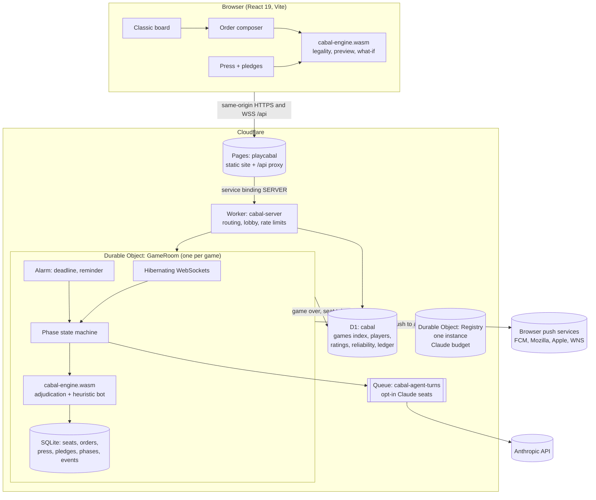
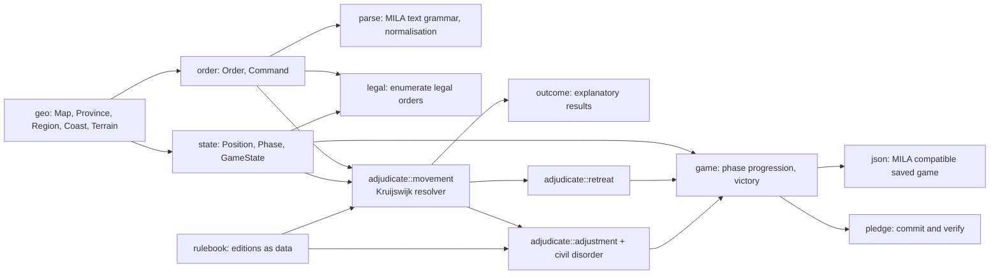
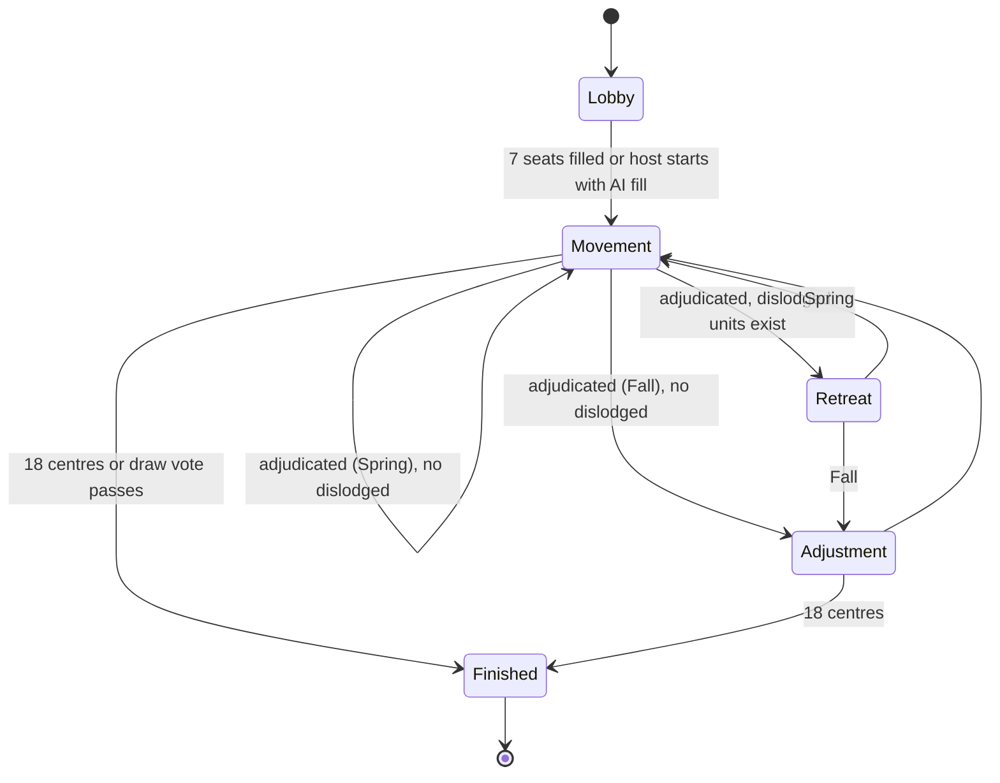

# Architecture

## 1. System overview



Five principles:

1. **One engine, two hosts.** The Rust crate is compiled once to WebAssembly. The browser uses it for instant feedback; the Durable Object uses it as the authority. They cannot disagree because they are the same bytes.
2. **One object owns one game.** All state for a game (positions, orders, press, pledges, deadlines, sockets) lives in one Durable Object with SQLite storage. Adjudication, persistence and broadcast are one transaction. No cross-service hop on the hot path.
3. **Layers above the line never touch the resolver.** Pledges, cabals, vendettas and ratings consume adjudication results. They cannot change them.
4. **One origin.** The browser only ever talks to `playcabal.pages.dev`. The Pages project proxies `/api/*`, including WebSocket upgrades, to the `cabal-server` Worker through a service binding named `SERVER`, so the content security policy can stay `connect-src 'self'`. In `vite dev` the same path is proxied to `http://localhost:8787`. The web app calls it through the typed client in `@cabal/protocol/client`: the games room (`/games`) and each table's lobby (`/g/:code`) are live; a seat token is kept in `localStorage` under the game's code and is never put in a URL.
5. **A service worker that never serves an old app.** `sw.js` is built after every build (`apps/web/src/sw`, bundled by `scripts/emit-agent-site.mjs`) with a version hashed from the files it precaches, so each deploy ships a new worker. Navigations go to the network first and fall back to the installed shell only offline and only for app routes; hashed `/assets` files are cache first; `/api`, sockets and other origins are never touched. A new build waits until the player chooses Reload on the update prompt.

## 2. Repository layout

```
cabal/
  crates/
    cabal-engine/    pure Rust: geo, orders, parser, resolver, phases, legality, json, pledges
    cabal-wasm/      wasm-bindgen + tsify bindings, generates TypeScript types
    cabal-bot/       the heuristic player: value maps, greedy planner, search over the real adjudicator
    cabal-cli/       `cabal` CLI: datc, explain, legal, replay, arena, version
  packages/
    engine/          @cabal/engine  npm wrapper around the wasm-pack output
    protocol/        @cabal/protocol  zod schemas for WebSocket and HTTP messages
    agents/          @cabal/agents  LLM player harness
  apps/
    web/             @cabal/web  Vite + React 19, Cloudflare Pages
    server/          @cabal/server  Worker, GameRoom and Registry Durable Objects, D1 migrations
  tools/             mapgen (the board from Natural Earth), the bench gate, the godip oracle check
  fuzz/              cargo fuzz targets for the parser and legal order sets
  docs/              PLAN, ARCHITECTURE, RULES, PROTOCOL, BOT, PERFORMANCE, ADRs
  .github/           CI, issue and PR templates
```

## 3. The engine (`crates/cabal-engine`)

### 3.1 Module map



### 3.2 Domain types

- `ProvinceId(u8)`: index into the map. `Region { province, coast: Option<Coast> }` is the thing a unit stands on (fleets on `stp` are on `stp(nc)` or `stp(sc)`).
- `Terrain::{Land, Coast, Sea}` on provinces; `Border { a: Region, b: Region, terrain }` on edges. An army crosses `Land` and `Coast` borders, a fleet crosses `Coast` and `Sea` borders. Coastal provinces are represented by one region per coast plus the land region, following the MIT `diplomacy` crate design.
- `Unit { power, kind: Army | Fleet, region }`.
- `Order { power, unit_kind, origin: Region, command }` with `Command::{Hold, Move { dest, via_convoy }, SupportHold { target }, SupportMove { target, dest }, Convoy { army, dest }}` for movement, `RetreatCommand::{Retreat(Region), Disband}` and `AdjustCommand::{Build(kind, Region), Disband(ProvinceId), Waive}`.
- `Outcome` enums explain every result: `Move::{Succeeds, Bounced(by), NoPath, Repelled, LostHeadToHead, FriendlyFire, ...}`, `Support::{Succeeds, Cut(by), Dislodged, Void}`, `Convoy::{Succeeds, Dislodged, Paradox}`.

### 3.3 Resolution

The movement resolver implements the partial information algorithm from DATC v3.0 chapter 5.E (Kruijswijk). Every order has a Boolean result that never changes once decided. `adjudicate(order, optimistic)` evaluates the rule equations (attack, hold, defend, prevent strength, path, support cut, convoy) using optimistic or pessimistic values for anything undecided; `resolve(order, optimistic)` memoises, detects dependency cycles with a `recursion_hits` counter, and applies the backup rule (circular movement succeeds; convoy paradox fails the convoys per Szykman). Illegal orders are stripped before resolution and never influence it. After resolution a final explanation pass turns Booleans into `Outcome` values.

`resolve_movement_with_dependencies` additionally returns `MovementDependencies`:
order and outcome nodes in stable region order, with sorted, deduplicated edges
`(a, b)` when resolving order `a` queries order `b`. Cached queries and cycle
edges are included; final explanation queries are excluded. This is an execution
trace of the equations queried, so short-circuited branches need not appear.
`MovementDependencies::to_dot(map, position)` renders labelled Graphviz DOT.
`cabal explain --graph "FRA: A PAR - BUR" "FRA: A MAR S A PAR - BUR"`
prints a standalone graph suitable for piping to `dot -Tsvg`. The original
`resolve_movement` API and result schema are unchanged. Over WASM the trace is
computed only on demand: `Game.explain(index)` re-runs the movement phase at
that history index with tracing and returns `{ edges, dot }`, where edges index
the phase outcome's `results`. Phase outcomes themselves carry no trace, so
processing, previews and history lookups never pay for it.

`order::normalise(map, position, order)` validates against the actual board unit
and canonicalises destination coasts. The additive WASM `Game.normaliseOrders`
method is shared by server adjudication and browser sandbox adjudication/replay
before `Game.process`. Invalid and duplicate orders are retained for diagnostics;
typed WASM processing also normalises movement orders.

Pre-processing decides statically whether an adjacent move uses a convoy (edition policy), matches supports and convoys to moves, and identifies head-to-head pairs (never when either side is convoyed).

### 3.4 Determinism and testing

- No I/O, no randomness in adjudication. Civil disorder tie breaks are alphabetical by province name.
- DATC v3.0 corpus (171 cases, Main, Retreat, Build, editions) drives `tests/datc.rs`. The independent `oracle_godip.json` corpus asserts full units, dislodgements, and owners for 18 godip production cases plus two official DATC cases. Provenance, phase-boundary adapters and the DATC 6.K note are in [ENGINE_VERIFICATION.md](ENGINE_VERIFICATION.md).
- Property tests (`proptest`): random legal order sets never panic, resolution is independent of order submission sequence, relabelling powers relabels outcomes.
- Explanation tests (`tests/dependencies.rs`) assert the dependency edges traced for supported attacks, cycles, convoys and illegal orders; the DATC corpus run also checks that tracing never changes a result and that the trace and its DOT are identical when orders are submitted in reverse.
- `criterion` benches: full board adjudication and explanation, legal order enumeration, map start-up. The CI `bench` job runs opening adjudication and the two fleet-heavy midgame legal-order benches on the base commit and on the change, back to back on one runner, and `tools/check-bench-regression.py` fails the build on a slowdown over 30 percent (`benches/baseline.json` is the fallback for local runs). Measured numbers, and what was tried and rejected, are in [PERFORMANCE.md](PERFORMANCE.md).
- `cargo fuzz` targets on the text parser and legal movement order sets live in `fuzz/`; the nightly Stress workflow runs each for 600 seconds and retains crash artifacts. See `fuzz/README.md`.

## 4. WebAssembly boundary (`crates/cabal-wasm`, `packages/engine`)

- Built with `wasm-pack build --target web --profile wasm-release` (`pnpm engine:build`). The bundled maps are compiled in as static tables by the engine's `build.rs`, so nothing is parsed when the module starts. The `.wasm` is imported by Vite via `?url` and by Wrangler through a `CompiledWasm` rule; both call the generated `init` once.
- `tsify` derives TypeScript types for every struct crossing the boundary, so `adjudicate(state, orders)` is typed end to end. Inputs cross via `serde-wasm-bindgen`; large results (legal orders, phase outcomes, explanations) are serialised once and parsed by the host, which is measurably faster than building them object by object.
- Exposed API (`packages/engine/src/index.ts`): `ready(source)` to instantiate once, a stateful `Game` class (`new Game(rulebook, map)`, `mapName`, `Game.fromState`, `Game.fromSaved`, `Game.resume`, `Game.fromSnapshot`, `phase`, `status`, `rulebook`, `state`, `legal(power)`, `legalAll`, `legalMoves(power?)`, `validateOrders(power, orders)`, `normaliseOrders`, `process(orders)`, `preview(orders)`, `outcome(index)`, `explain(index)`, `explainPreview(orders)`, `historyLength`, `toSaved`, `snapshot`, `declareDraw(members)`, `drawMembers`, `recordMessage`, `recordPledge`, `pledgeCheck`, `pledgeReceipt`), and the free functions `version`, `buildInfo`, `mapInfo`, `preview(state, orders, rulebook)`, `explainPreview(state, orders, rulebook)`, `validateOrders(state, power, orders, rulebook)`, `canonicalOrder`, `verifySaved`, `pledgeCommit`, `pledgeOpens`, `pledgeReceipt` and `randomNonce`. Retreats and adjustments go through the same `process` call as movement. `process` never rejects a phase over one order: what cannot be adjudicated comes back in `rejected` with a code and a sentence, and is kept in the saved game. `new Game`, `Game.fromState`, `mapInfo` and the stateless helpers take an optional map name (`standard` or `duel`); a saved game names its own map. `validateOrders` judges orders against the board before they are sent; `explain` returns, per result, a sentence, the units responsible, the strengths, cut supports, broken convoys and paradox cycles. `fromSaved` adjudicates a file again and is for imports; `resume` and `fromSnapshot` trust the record and are for restoring your own storage (see [ENGINE_VERIFICATION.md](ENGINE_VERIFICATION.md)).

## 5. Server (`apps/server`)

### 5.1 GameRoom Durable Object



- Connections use the Durable Object WebSocket Hibernation API directly (`ctx.acceptWebSocket`, no framework). Each socket carries the seat it authenticated as in a serialised attachment, so it survives hibernation.
- One alarm per object serves every timer it has (`nextAlarmAt` in `deadlines.ts`): the phase deadline, the deadline reminder, a bounded pause, an AI turn running out, an adjudication retry, a lobby that never started and the index hand-off. On the deadline: apply sealed defaults or holds for missing orders, adjudicate with the WASM engine, persist, broadcast, schedule the next alarm. The transaction is atomic inside the object.
- "Ready to advance": when all seated players mark ready, the deadline collapses to now.
- Every adjudicated phase is an append-only row in `phases`, and every broadcast is an append-only row in `events` with a sequence number, so a reconnecting client asks for everything `since` its last `seq`. Replays are reads.

### 5.2 SQLite schema (per game)

The schema is the `SCHEMA` constant in `apps/server/src/room.ts`, which is the source of truth; this is its outline. The game's own metadata and engine state are kept in the object's key value storage.

```
seats(power, kind human|ai|open|civil_disorder, name, token_hash, ready, missed, eliminated, player_id)
stints(power, stint, player_id, name, joined_at, substitute, left_reason, due, on_time, late)
seat_tokens(token_hash, power, created_at)
orders(phase, power, orders_json, submitted_at, source)
defaults(power, orders_json)
press(id, phase, sender, recipient, body, sent_at, pledge_id)
pledges(id, pledger, audience, phase, sealed, commitment, nonce, orders_json, receipt, pledger_player, audience_player)
votes(power, kind, value, include_json)
phases(seq, name, results_json, adjudicated_at, summary_json)
events(seq, audience, payload_json, snapshot)
```

A `stint` is one holder's time at a seat: a seat that went to a substitute has two. Stints carry the reliability counters (phases the seat had something to order, ordered in time, ordered in the grace period), and pledges remember which player made them to which, so the record a finished game hands the index can say exactly who did what.

### 5.3 Cross-game data: D1, behind the `GameIndex` port

Data that spans games lives in the D1 database `cabal` (binding `DB`), reached only through two ports in `apps/server`: `GameIndex` (finished games, public listings, seats signed-in players hold) and `PlayerStore` (accounts, ratings, reliability, the trust ledger), both implemented by `d1-index.ts`. The schema is the numbered SQL files in `apps/server/migrations/`, applied with `wrangler d1 migrations apply cabal` and, in tests, by the workerd suite before it runs, so tests and production share one schema. See [ADR 0010](adr/0010-d1-index-registry-for-the-claude-budget.md).

- **Games.** `games_index` (one row per ended game), `games_live` (public lobbies and running games), `game_players` (one row per stint: player, share of the result, phases due, on time and late, counted receipts).
- **Players.** `players` (id, handle, the hash of the recovery code), `player_sessions` (the hash of each device's secret), `handle_aliases` (handles given up in the last 90 days).
- **Standing.** `ratings` and `rating_history` (weighted pairwise Glicko-2, [ADR 0011](adr/0011-weighted-pairwise-glicko-2.md)), `rated_games`, and `player_stats` (totals, reliability and trust, recomputed from `game_players` in one statement whenever a player's game ends).

A `GameRoom` hands a finished game to the index once, through a durable outbox that retries with backoff. Recording is idempotent; a game is rated at most once (its `rated_games` row is the first statement of the rating batch) and two games ending at once for the same player cannot lose an update (the batch re-checks each player's rating count and is retried on a conflict). Every multi-row change is one D1 batch, which is one transaction.

The `Registry` Durable Object (one instance, `idFromName("global")`) stays deployed for the one thing that wants a single writer: the deployment-wide Claude budget, where two games asking at once must never both take the last place. It also holds the games index from before D1, which is copied into D1 once, in the background of the first request an isolate serves, without overwriting anything newer. Where no D1 database is bound (bare local setups), the Registry serves the games index as it did before and there are no players.

### 5.4 Identity

Identity is guest first. `POST /api/players` makes an account (a random id and a handle, chosen or picked) and returns a 192-bit secret once; the server stores only its SHA-256, one row per device. A recovery code (100 bits, Crockford base32) restores the account on another device; issuing a new one retires the old. There are no passkeys or email sign-in on `pages.dev`. Handles are unique whatever their case and filtered for impersonation of the house and the worst abuse.

A signed-in player sends their secret as the bearer on create and join. The router resolves it and tells the room who the player is in the request body (rooms are reachable only through the router), so the seat binds to the player id: one seat per player per game, ever, and the seat token can be issued again on another device (`POST /api/games/:id/seat`). Anonymous play still works with a name and a seat token. Seat tokens never appear in URLs; a socket authenticates with its first `hello` frame.

### 5.5 Notifications

Web Push tells a signed-in player who is away from a game (no socket open for their seat) that it began, that a phase resolved and they have orders to write, that a private dispatch arrived, that their orders are due soon, and that it ended. A room collects these notices inside the same transaction as the change that caused them, so a rolled-back change tells nobody anything, and hands them to `notify.ts` once the change has committed (`ctx.waitUntil`). The deadline reminder is one more instant on the room's alarm: `PUSH_REMINDER_MINUTES` before the deadline, once per phase, in phases at least twice that long, for the players who can act and have filed nothing.

- **Storage.** `push_subscriptions` (one row per browser, tied to the device session that subscribed it, so signing that device out forgets it by cascade; a player keeps five) and `notification_preferences` (one switch per kind) in D1, migration 0010.
- **Delivery.** `push.ts` implements RFC 8291 message encryption (ECDH with the subscription key, HKDF with its auth secret, one AES-128-GCM record) and RFC 8292 VAPID (an ES256 JWT per push service, cached for eleven hours) with Web Crypto alone; npm `web-push` needs Node's `crypto` and `https`. A test reproduces RFC 8291's worked example byte for byte. Endpoints must be known push services over https, so the server never posts to an address a caller chose. A 404 or 410 deletes the subscription; other failures are counted and a subscription that fails twenty times in a row is dropped.
- **Content.** A push decrypts to `{ kind, gameId, title, body, url, tag, sentAt }`: what happened and a link to the game, never orders, press text or anything sealed.
- **Keys.** `VAPID_PUBLIC_KEY` is in `wrangler.jsonc`; the private key is the secret `VAPID_PRIVATE_KEY`. Without it push is off and no reminder is scheduled.

### 5.6 Observability and metrics

- **Logs.** One JSON object per line with `ts`, `level`, `event`, `service` (`worker`, `room`, `queue`) and `requestId`. The id is set where work enters (Cloudflare's ray id for HTTP, a fresh id for each socket frame, alarm and queue message), carried through every await by AsyncLocalStorage (`log.ts`), handed to a room in the `x-request-id` header and to its RPC methods as an argument, and returned to the client in `x-request-id`. Every HTTP request gets one `request` line with its route label, status and time. Logs never carry tokens, secrets, press text or addresses.
- **Phase 1 metrics** (#57). The four success metrics of PLAN.md section 8 are kept in D1 with no player, address or device in any row: a finished game is an event (`metric_events`, migration 0011) recorded by the index in the same batch as its own row; browsers send order round trips and landing-to-game times to `POST /api/metrics`, folded into daily histograms per continent (`metric_buckets`, migration 0012) so anonymous traffic can never grow storage without bound, behind a per-address limit (`METRICS_LIMITER`, 6 a minute), 10 samples a beacon and a deployment-wide cap of 20,000 samples a day; their verdicts are marked self-reported; `scripts/report-datc.mjs` records the DATC case totals for a commit. `GET /api/metrics`, behind `ADMIN_TOKEN`, judges each against its target. No third-party analytics.
- **Cold start** (#61). The engine logs, once per isolate, how long instantiation, the first game and the first adjudication took. `scripts/cold-start.mjs` measures them in fresh workerd processes and CI gates them; the numbers and how to read them in production are in [PERFORMANCE.md](PERFORMANCE.md#gameroom-cold-start).

## 6. Protocol

The WebSocket protocol (version 2, `PROTOCOL_VERSION` in `@cabal/protocol`, also reported by `/health`) is specified in [PROTOCOL.md](PROTOCOL.md) and enforced with zod schemas in `@cabal/protocol`; a test fails when the page and the schemas disagree. A socket opens as a spectator and binds to a seat with a first `hello` frame, every broadcast carries a sequence number, and a client that reconnects resumes with `sync { since }` instead of reloading the game. Order text follows the MILA / Cicero notation (`A PAR - BUR`, `F NTH C A LON - BRE`, `A LON - BRE VIA`) so existing AI research tooling and saved games interoperate.

## 7. Agents (`packages/agents`)

AI seats always play and never block a phase. The default brain is a deterministic heuristic bot written in Rust (`crates/cabal-bot`, exposed through `@cabal/engine`) that runs inside the `GameRoom`: no cost, no latency, no network. A game can opt in to Claude brains (`settings.aiBrain: 'claude'`) when `ANTHROPIC_API_KEY` is set; their turns go through the `cabal-agent-turns` queue (dead letters to `cabal-agent-turns-dlq`) under a hard per-game spend cap and a deployment-wide daily budget kept by the `Registry` Durable Object (which admits a game to Claude before it starts), and any failure falls back to the bot. A game with no active human seats ends instead of playing itself forever. Status: the bot plays every AI seat and covers every seat in civil disorder inside the `GameRoom` (`apps/server/src/bot.ts`), and is described in [BOT.md](BOT.md). The Claude path is built and tested with a scripted model; it stays off in production until `ANTHROPIC_API_KEY` is set.

A Claude agent (`@cabal/agents`) is just another client. It receives the same state and message stream, builds a narrative prompt (board story, legal orders, diary, relationships), asks Claude for reasoning plus structured output, validates orders against the legal list with a repair pass, and submits through the protocol. Pledges are first class: the agent can seal commitments and reads the trust ledger of opponents.

## 8. Web (`apps/web`)

- Vite, React 19, TypeScript strict, no component library. Typography: Archivo Black for display, Inter Tight for the interface, IBM Plex Mono for orders and province codes. Palette and wordmark come from the brand concepts in `docs/brand`.
- The board is `src/map/board.json`, generated by `tools/mapgen` from Natural Earth admin-1 regions: 76 province paths, coastline and sea boundary strokes, impassable land, and anchors for units, labels, supply centres and named coasts. It loads as a separate chunk.
- `src/game/compose.ts` is a pure, unit-tested state machine for Backstabbr-style ordering (unit then destination, click twice to hold, S and C for support and convoy, coast picker). It only emits orders present in the engine's legal list.
- `src/game/useSandbox.ts` owns the engine `Game`, the order book per power, the phase history (for replay and undo by re-adjudication) and MILA import and export.
- The board supports zoom (buttons, ctrl or pinch wheel, two-finger pinch) and drag to pan when zoomed.
- **The edge.** Pages runs in advanced mode: `scripts/emit-agent-site.mjs` bundles `worker/entry.ts` (which calls `src/agent/gateway.ts`) into `dist/_worker.js`. The gateway forwards `/api/*`, sockets included, to `cabal-server` through the `SERVER` service binding; answers every app route with the shell and that route's own title, description and share card; serves the prerendered front door; hands Markdown to clients that ask for it (`Accept: text/markdown`, `/llms.txt`); and returns real 404s.
- **Counts the site quotes.** The number of adjudication test cases on the footer, the front door and How to play comes from `src/app/adjudication.json`, which `src/app/adjudication.test.ts` holds to the engine's own fixtures.

## 9. Deployment

- Deploys are run by a maintainer from a machine logged in with `npx wrangler login`; CI holds no Cloudflare credentials.
- `pnpm deploy:web` builds the engine and site and publishes `apps/web/dist` to Cloudflare Pages as `playcabal.pages.dev`.
- `pnpm deploy:server` builds the engine, applies the D1 migrations to the remote `cabal` database, then runs `wrangler deploy` for `apps/server`. Durable Object migrations are declared in `wrangler.jsonc`.
- `pnpm deploy:all` does both (a bare `pnpm deploy` is a built-in pnpm command, not this script). Run it from an up to date `main` after CI is green.
- CI (`.github/workflows/ci.yml`): Rust fmt, clippy, docs, tests and the DATC report; an adjudication benchmark gate; the wasm build with a gzip size budget; Node typecheck, lint, unit and workerd tests; Playwright; dependency and workflow audits; and a deploy dry run that bundles `cabal-server` with `wrangler deploy --dry-run` (no credentials) under a gzip size budget; and a GameRoom cold start gate (`cold-start` job) that measures fresh workerd processes on the base commit and on the change. The full deploy runbook is in [CONTRIBUTING.md](../CONTRIBUTING.md#deploying) and the decision in [ADR 0008](adr/0008-manual-wrangler-deploys.md).
- Nightly (`stress.yml`): fuzzing, property tests with a larger case budget, and a bot arena: 300 seeded games between the three levels of the heuristic bot (`cabal arena`), failing on any illegal order, incomplete decision, self-contradicting order (a void support or convoy), panic, replay divergence or strength-order regression, with the summary and every saved game uploaded as an artifact. No model is called and no secret is needed.

## 10. Security and fairness

- Clients never assert who they are. The socket tag from the authenticated join is the identity.
- Orders are only accepted for the seat bound to the socket.
- Pledge commitments are BLAKE3 hashes over canonical order text plus a 128 bit nonce; sealed pledges reveal after adjudication.
- Per-IP rate limits through Workers rate limiting bindings: game creation (`CREATE_LIMITER`), seat joins and seat recovery (`JOIN_LIMITER`), reads and socket upgrades (`READ_LIMITER`), metric beacons (`METRICS_LIMITER`), and making or restoring accounts (`ACCOUNT_LIMITER`); changes to an account are limited per player (`PROFILE_LIMITER`).
- Player secrets, seat tokens and recovery codes are stored only as hashes. A player secret that does not authenticate is refused, never treated as anonymous play.
- Ratings count only games between signed-in humans: bots and anonymous seats are not opponents, unlisted games are not rated, a rated game must last two years and seat three distinct players, and a pledge counts towards a player's trust ledger only when it was made to another person, in a game that meets the rated bar, once per audience per phase. Handles are unique by how they read (case, `_` and `-`, and look-alikes such as `1`, `i` and `l` are folded together).
- Push subscriptions only reach known push services, and push payloads carry no orders, press text or tokens. Metrics events hold no personal data.
- Multi-account heuristics and moderation hooks are not built and are not yet scheduled to an issue.
