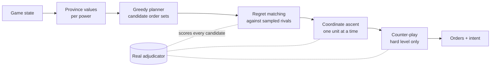

# The house player

`crates/cabal-bot` is the bot that plays every AI seat by default. It is a few hundred lines of search wrapped around the real adjudicator: no neural network, no language model, no network call, no cost. It is compiled into the same WebAssembly module as the engine, so the Durable Object that owns a game can ask it for orders in about a millisecond and never has to wait on anything.

This page explains how it decides, what it guarantees, and how strong and how fast it measurably is. Every number below comes from a command you can run.

## 1. What you get

```rust
pub fn decide(map: &Map, rulebook: Rulebook, state: &GameState,
              power: Power, seed: u64, level: Level) -> Decision;

pub struct Decision { pub orders: Vec<AnyOrder>, pub intent: Intent }
```

```ts
import { botOrders } from "@cabal/engine";

const { orders, intent } = botOrders(game, "FRANCE", { seed: gameId, level: "standard" });
game.process({ orders: { FRANCE: orders } });
```

One call covers all three phase kinds. The promises, each one enforced by a test:

| Promise | How it is kept | Where it is tested |
|---|---|---|
| Deterministic | All scoring is integer arithmetic, the generator is a seeded SplitMix64, nothing iterates a hash map, and the compute budget is counted in adjudications, never in milliseconds. The same state, power, seed and level give the same decision natively and in WebAssembly. | `tests/properties.rs`, `engine.test.ts`, `tests/arena.rs` (two runs with different thread counts write byte-identical games) |
| Legal | The planner only builds orders from the map's own adjacency, and every order is passed through the engine's validator (`order::normalise`, the same function the resolver uses) on the way out. | Property test: every order is on `legal_movement` / `legal_retreats` / `legal_adjustments`, and adjudicating the set yields no `Illegal` outcome |
| Complete | Exactly one order per unit and per dislodged unit. Builds and disbands always fill the allowance; a build that has no free home centre is an explicit `WAIVE`. | Property test and the build puzzles |
| No duplicates | One order per unit, no two builds on one centre, no two of its own retreats to one province. | Property test |
| Never panics | Unknown powers and states that do not belong to the map get an empty decision. | `prop_never_panics_on_arbitrary_states` feeds it boards the rules could never produce |

A single seed serves a whole game: it is mixed with the phase, the power and the level, so every decision draws from its own stream. `botOrders` takes the seed as text (hashed with FNV-1a in Rust), so a game id works as is.

## 2. How it decides a movement phase



### 2.1 Province values (`values.rs`)

The starting point is the idea behind the DAIDE-era DumbBot, recast in integers. Each supply centre gets a base value for the power that is thinking:

- a centre nobody owns: 130;
- a centre another power owns: 80 plus 4 per centre that power has, plus 25 for each centre it has beyond nine (stop the leader), plus 20 if it has two or fewer (it cannot defend them);
- one of its own centres: nothing if no enemy can reach it, otherwise 45 per enemy unit in reach (up to three) and 30 more for a home centre.

That base map is then averaged outward over the board four times, and the five layers are combined with season-dependent weights: in Spring the provinces next to a prize weigh most (get into position), in Fall the prize itself does (be standing on it when ownership is counted). Armies and fleets get separate maps because they move on different graphs, and a fleet's map ignores inland centres it can never enter.

### 2.2 The greedy planner (`plan.rs`)

`plan::sample` turns a value map into one complete joint order set:

1. Units choose destinations in turn. Each takes its best-scoring option that no friend has claimed: stay, any adjacent province, or (for an army on the coast next to one of its own fleets at sea) a one-fleet convoy to a coast that fleet touches. The score is the province value plus tactical terms: a bonus for a centre it does not own (larger in Fall, smaller when defended or contested), a bonus for staying on a threatened centre of its own, a penalty per enemy unit able to move to the same place.
2. Supports are handed out. Every attack on an occupied or contested province and every hold on a threatened centre becomes a task with a need. Units that are idle, or whose own move is worth clearly less than the task, are converted into supporters, cheapest first.
3. Repairs. No unit is left walking into a friend who is not leaving, and two friends never try to swap places.

With zero noise this is "the obvious plan". With seeded noise added to every score it produces plausible variations. The planner is used three ways: as the whole of the easy level, as the source of the searching levels' own candidates, and as the model of what every other power might do.

### 2.3 Regret matching over real adjudications (`search.rs`)

Every power with units gets candidate order sets from the planner. The bot gets the most; each *nearby* rival (a power with a unit or a centre within two provinces of the bot's) gets a few; distant powers get just their obvious plan. A rival's second candidate is always its obvious plan under a value map that prizes the bot's centres: the attack that power *could* launch is therefore always on the table, whether or not it is that power's favourite.

Then a short regret-matching loop runs, the same scheme as SearchBot (Gray et al., ICLR 2021) with the neural networks removed:

- each iteration samples one candidate per searching power from its current policy (in proportion to positive regret);
- every alternative of every searching power is adjudicated against that sample with `resolve_movement`, the engine's real resolver, and scored for its owner;
- regrets accumulate.

One adjudication scores the board for everybody, so the rivals learn to answer the bot at the same time as the bot learns to answer them. The bot keeps the candidate with the best average score.

### 2.4 The evaluation

A resolved phase is scored for one power as the sum of:

- the value-map worth of every province its units ended in;
- in Fall, +1000 for each centre it stands on and did not own, and -1000 for each of its centres an enemy stands on (-1150 for a home centre);
- a forecast for every supply centre next turn: who stands on it, how many of the power's units can reach it, and how many of the strongest rival's can. A prize it can take with superior numbers scores well, a prize it merely stands near scores a little, one of its own centres that can be outnumbered scores badly. In Spring this is the forecast of the Fall count and carries full weight; in Fall it carries three tenths;
- -320 for each of its units dislodged, +140 for each unit it dislodges.

### 2.5 Coordinate ascent

The chosen candidate is then repaired one unit at a time. For each unit, in order of how much enemy contact it has, the bot tries every alternative order (hold, each move, support for any friend's move or hold it can reach) and, at the hard level, every attacker-plus-supporter pair as a single change. Each trial is adjudicated against the most recent rival samples; a change is kept only when the summed score is strictly better. This step is where most of the playing strength comes from: in an ablation during tuning (70 games, an earlier parameter set), a standard bot with this step switched off finished ahead of the unmodified one in only 40% of pairings.

### 2.6 Counter-play (hard only)

Finally the hard level asks what happens if the neighbours see it coming. Each nearby rival in turn best-responds, by the same coordinate ascent, to the orders the bot has settled on. The resulting board becomes one more world, and the bot refines again against all of them. Two rounds. This is iterated best response, and it is what makes the bot guard against the supported attack it would itself launch from the other side.

### 2.7 Levels and budgets

| | easy | standard (default) | hard |
|---|---|---|---|
| Own candidates | 1, with heavy noise | 6 | 12 |
| Candidates per nearby rival | none | 2 | 3 |
| Regret-matching iterations | none | 3 | 6 |
| Rival worlds for refinement | none | 2 | 2, plus up to 2 from counter-play |
| Refinement sweeps | none | 1 | 2 |
| Attacker and supporter pairs | no | no | yes |
| Counter-play rounds | none | none | 2 |
| Hard cap on adjudications | 0 | 200 | 3000 |

The cap is the compute budget. Because it is a count and not a clock, a slow machine takes longer but decides the same thing.

## 3. Retreats and winter

**Retreats** (`retreat.rs`). Every legal retreat is scored by the value map, with a large bonus for a centre the power does not own (Fall) and a smaller one for falling back onto its own centre, more when that centre is under threat. Squares that another power's dislodged unit could also choose are penalised, because two units retreating to one province both die. Destinations are handed out best first, never the same one twice. A unit is disbanded only when it has no legal retreat.

**Builds** (`adjust.rs`). The bot reads the fleet share it ought to have off the map: it measures how near every centre it does not own is to its home centres by land and by sea, and wants fleets in proportion (clamped between 15% and 75%). England wants a navy; Austria does not. Each build then goes to the free home centre and unit kind with the best mix of position value, outlook for next Spring, guard duty against enemy units in reach, and progress toward that share. Builds beyond the free home centres are waived explicitly.

**Disbands**. Units are ranked by what they are doing (guarding a threatened centre, standing next to a prize, sitting somewhere valuable) and the least useful go first.

## 4. The intent summary

Every decision carries a small, machine-readable account of itself for the press layer and the UI:

| Field | Meaning |
|---|---|
| `targets` | Provinces it is trying to take or enter against opposition, best first |
| `against` | The powers those provinces or the units on them belong to |
| `defends` | Its own threatened centres it is holding or supporting |
| `supports` | Each support it ordered: supporter, supported unit, destination, and whose unit it is |
| `fears` | Rivals with units in reach of its centres (counted twice) or its units, most dangerous first |
| `candidates`, `adjudications` | How hard it thought |

Through WebAssembly these arrive as province codes, unit text and power names (`"MUN"`, `"A BOH"`, `"GERMANY"`).

## 5. Measured

All figures in this section are from one run of the nightly arena job on a GitHub-hosted `ubuntu-latest` runner (4 threads): 300 games to the end of 1910, seed 66, levels `hard,standard,easy`, with every power playing every level once per block of three games. [Run 44450259925](https://github.com/KarthikSubramanian07/Cabal/actions/runs/44450259925); the summary and all 300 saved games are attached to it as an artifact.

### 5.1 Strength

Every pair of seats in the same game with different levels, 1,600 pairings each. "Ahead" is how often the row level finished with more centres than the column level (ties count half).

| | vs hard | vs standard | vs easy |
|---|---|---|---|
| **hard** | | 66.1% ahead, +3.50 centres | 82.9% ahead, +6.57 centres |
| **standard** | 33.9% ahead, -3.50 centres | | 68.7% ahead, +3.17 centres |
| **easy** | 17.1% ahead, -6.57 centres | 31.3% ahead, -3.17 centres | |

| Level | Seats | Solos | Share of the result per seat | Mean final centres | Survived to the end |
|---|---|---|---|---|---|
| hard | 700 | 67 | 23.0% | 8.14 | 89.0% |
| standard | 700 | 10 | 12.2% | 4.75 | 72.6% |
| easy | 700 | 0 | 7.7% | 1.68 | 51.3% |

An even share would be 14.3% per seat. The nightly job fails if a stronger level finishes ahead of the next one down in fewer than 55% of pairings.

### 5.2 The games

| Measure | Value |
|---|---|
| Solos | 77 of 300 (25.7%) |
| Draws at the end of 1910 | 3-way 8, 4-way 49, 5-way 76, 6-way 71, 7-way 19 |
| Average length | 42.6 phases |
| Orders adjudicated | 209,479 |
| Illegal orders | 0 |
| Incomplete decisions | 0 |
| Replay divergences | 0 (checked in process, then again by `cabal replay` on all 300 files) |

| Power | Solos | Share of the result | Mean final centres | Survived |
|---|---|---|---|---|
| Austria | 2 | 8.3% | 2.57 | 53.0% |
| England | 3 | 12.9% | 6.50 | 73.7% |
| France | 41 | 25.1% | 7.06 | 81.0% |
| Germany | 3 | 10.2% | 2.83 | 59.0% |
| Italy | 12 | 16.9% | 5.36 | 82.7% |
| Russia | 5 | 10.5% | 3.19 | 63.7% |
| Turkey | 11 | 16.2% | 6.49 | 83.7% |

The corner powers do well and the central ones suffer, as in human no-press play, but the gap is wider than it should be: France takes more than half of all solos. See section 7.

### 5.3 Speed

| Measure | Value |
|---|---|
| Arena throughput | 3.2 games per second on 4 threads (300 games in 92.8 s) |
| Mean decision, native, easy | 0.02 ms (slowest 1.6 ms) |
| Mean decision, native, standard | 1.29 ms (slowest 13.0 ms) |
| Mean decision, native, hard | 17.5 ms (slowest 189 ms) |
| Decision in WebAssembly, standard, Node 24 on the same class of runner | 1.20 ms median, 2.54 ms slowest of 42 on a 1905 board |
| WebAssembly module, gzip | 270,613 bytes (it was 223,076 before the bot; the CI budget is 409,600) |

The native times are means over every decision of the 300 games, measured while four games ran at once. The WebAssembly figure is printed by `packages/engine/src/engine.test.ts` on every CI run ([this one](https://github.com/KarthikSubramanian07/Cabal/actions/runs/44451474397)); that test also asserts that the default level never spends more than 200 adjudications, which is exact on every machine, and that its fastest decision stays under 30 ms, which catches a gross slowdown without failing on a busy runner.

So the default level decides in about a millisecond, natively or in WebAssembly, against a budget of 30. Seven AI seats cost the Durable Object roughly ten milliseconds a phase. The hard level spends up to 3,000 adjudications, about fifteen times as much, and should be reserved for games that ask for it. The headroom at the default level is deliberate: it leaves room to raise the standard budget later without touching the 30 ms promise, and the arena is the instrument for deciding whether that is worth it.

## 6. Reproducing it

```sh
# 300 games, mixed levels, with the strength gate, into ./arena
cargo run --release -p cabal-cli -- arena --games 300 --seed 66 --max-year 1910 \
  --levels hard,standard,easy --out arena --check-strength

# every saved game re-adjudicates
find arena/games -name '*.json' -print0 | xargs -0 -n 1 target/release/cabal replay

# decision time
cargo bench -p cabal-bot --bench decide

# the tests
cargo test -p cabal-bot
PROPTEST_CASES=1000 cargo test -p cabal-bot --release -- prop_
```

`cabal arena` writes `summary.json` (everything above plus one record per game: seed, seating, result, centres), `summary.md`, and `games/<id>.json`. Apart from the timing fields the output is a pure function of the arguments, whatever `--jobs` is. It exits non-zero on any illegal order, incomplete decision or replay divergence, and with `--check-strength` on a strength-order regression. A panic aborts the process, since release builds use `panic = "abort"`.

The nightly `Stress` workflow runs exactly this with a new seed each night (the run number), preceded by the bot's property tests at 1,000 cases.

## 7. What it does not do

- **It does not talk.** It sends no press and reads none. The intent summary exists so that a press layer can be built on top without re-deriving the plan.
- **It looks one phase ahead.** The Spring forecast is a static count, not a played-out Fall. A two-ply search is the obvious next step and the arena is there to prove whether it pays.
- **Convoys are one fleet long.** It will carry an army across one sea zone. It will not build a chain.
- **It never supports a foreign unit.** Without press there is no way to agree one.
- **The middle of the board plays too passively.** Austria and Germany survive in only 53% and 59% of games. The evaluation punishes an exposed centre more than it rewards initiative, which suits a corner power and starves a central one.
- **Variants.** Nothing is specific to the standard map (the adjacency tables are built from whichever `Map` it is given), but only the standard map has been measured.

## 8. Credits

The value map follows the published description of David Norman's DumbBot from the DAIDE project. The search follows the one-step lookahead with regret matching of "Human-Level Performance in No-Press Diplomacy via Equilibrium Search" (Gray, Lerer, Bakhtin and Brown, ICLR 2021), without its learned policy and value networks. No code from either was used.
